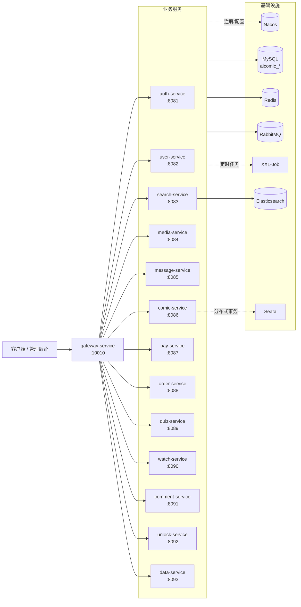

# AI 漫剧内容管理与分发平台

一个面向 AI 漫剧（AI 生成的漫画短剧）场景的微服务后端，覆盖内容生产、用户体系、搜索推荐、播放互动、付费解锁、消息通知与数据看板等完整链路。

> **说明**：本项目在开源微服务工程的基础上进行了较大幅度的业务重构与二次开发，领域模型、接口设计、数据表结构均已改造为漫剧内容平台的形态。项目主要用于学习与交流微服务架构实践。


---

## 目录

- [项目简介](#项目简介)
- [功能特性](#功能特性)
- [技术栈](#技术栈)
- [系统架构](#系统架构)
- [服务清单](#服务清单)
- [工程结构](#工程结构)
- [请求与鉴权流程](#请求与鉴权流程)
- [快速开始](#快速开始)
- [配置说明](#配置说明)
- [开发规范](#开发规范)
- [测试](#测试)
- [致谢与许可](#致谢与许可)

---

## 项目简介

平台围绕「漫剧」这一内容形态展开：

- **内容侧**：创作者上传漫剧作品与剧集，平台按分类、标签组织内容；
- **消费侧**：观众浏览、搜索、播放剧集，记录观看进度，参与点赞、评论、笔记与互动问答；
- **商业化**：支持剧集付费解锁、限时活动、优惠券、兑换码，以及支付宝/微信支付与退款；
- **运营侧**：后台提供用户与权限管理、内容审核、消息推送和数据看板。

后端采用 Spring Cloud 微服务架构，按业务域拆分为多个独立服务，每个服务独享数据库，服务间通过 OpenFeign 同步调用、RabbitMQ 异步解耦，并由网关统一完成路由、认证与请求追踪。

## 功能特性

| 模块 | 能力 |
|---|---|
| 统一网关 | 路由转发、JWT 认证、权限校验、请求 ID 透传、跨域、接口聚合文档 |
| 认证授权 | 登录 / 刷新 Token、JWT（RS256）、角色、菜单、权限点、JWKS 公钥分发 |
| 用户体系 | 普通用户、观众、创作者、管理员，多角色分端管理 |
| 内容管理 | 漫剧作品、剧集、分类、标签、草稿发布（Seata 全局事务） |
| 搜索推荐 | 基于 Elasticsearch 的内容检索、兴趣标签、推荐流 |
| 媒体处理 | 视频 / 图片 / 素材上传，腾讯云 COS / VOD 存储与播放签名 |
| 播放互动 | 观看进度、观看记录、笔记、点赞、评论、积分、签到、互动问答 |
| 交易支付 | 购物车、订单、支付回调、退款申请，支付宝 / 微信双通道 |
| 解锁营销 | 限时解锁、优惠券领取与核销、兑换码，Redis + Lua 保证原子性 |
| 消息通知 | 短信模板与发送、站内信、公告任务，多短信厂商适配 |
| 数据看板 | 今日数据、榜单 Top10、运营看板 |

### 核心技术实践

- **网关统一认证**：JWT 校验 + Redis 权限缓存，下游服务通过 `user-info` 请求头与 `UserContext` 传递身份，Feign 调用自动透传。
- **全链路请求追踪**：`requestId` 贯穿网关、服务、Feign、MQ 消费与日志 MDC。
- **异步与延迟任务**：RabbitMQ 处理内容/订单/支付/点赞等领域事件，延迟消息用于订单超时与退款流程；XXL-Job 负责定时任务。
- **最终一致与分布式事务**：失败消息进入 `error.topic` 重投；内容发布使用 Seata `@GlobalTransactional`。
- **分布式锁与原子操作**：Redisson `@Lock`（支持 SpEL 锁名），优惠券领取使用 Lua 脚本。
- **策略化扩展**：支付渠道（支付宝/微信）、存储（阿里/腾讯）、短信厂商、优惠策略与适用范围均以策略模式组织。

## 技术栈

| 分类 | 技术 |
|---|---|
| 语言 / 运行时 | Java 11 |
| 基础框架 | Spring Boot 2.7.2、Spring Cloud 2021.0.3、Spring Cloud Alibaba 2021.0.1.0 |
| 服务治理 | Nacos（注册中心 + 配置中心）、OpenFeign、Spring Cloud Gateway |
| 数据访问 | MyBatis-Plus 3.4.3、MySQL 8.0 |
| 缓存 / 锁 | Redis、Redisson 3.13.6 |
| 消息队列 | RabbitMQ |
| 搜索 | Elasticsearch 7.12 |
| 分布式事务 | Seata 1.5.1 |
| 任务调度 | XXL-Job 2.3.1 |
| 接口文档 | Knife4j / Swagger 3.0.3 |
| 对象存储 / 点播 | 腾讯云 COS、腾讯云 VOD |
| 支付 | 支付宝、微信支付 |
| 工具库 | Hutool、Lombok、Caffeine |

## 系统架构



### 分层结构

每个业务服务遵循统一分层：

```text
controller  →  service/I*Service + service/impl  →  mapper  →  domain/{po,dto,vo,query}
```

- 复杂 SQL 放在 `src/main/resources/mapper/*.xml`；
- 每个服务只访问自己的 `aicomic_*` 数据库，不共享实体；
- 跨服务调用只使用 `ac-api` 中定义的 DTO 与 Feign Client。

## 服务清单

| 服务 | 应用名 | 端口 | 网关前缀 | 数据库 | 职责 |
|---|---|---:|---|---|---|
| `gateway` | gateway-service | 10010 | — | — | 路由、JWT 认证、请求 ID |
| `auth/ac-auth-service` | auth-service | 8081 | `/as` | aicomic_auth | 登录 / JWT、角色、菜单、权限 |
| `user` | user-service | 8082 | `/us` | aicomic_user | 用户、观众、创作者、管理员 |
| `search` | search-service | 8083 | `/ss` | aicomic_search | ES 内容搜索、兴趣标签、推荐 |
| `media` | media-service | 8084 | `/ms` | aicomic_media | 视频 / 图片 / 素材上传、播放签名 |
| `message/ac-message-service` | message-service | 8085 | `/sms` | aicomic_message | 短信、公告、站内信 |
| `comic` | comic-service | 8086 | `/mc` | aicomic_comic | 漫剧、剧集、分类、标签 |
| `pay/ac-pay-service` | pay-service | 8087 | `/ps` | aicomic_pay | 支付宝 / 微信支付、退款、支付回调 |
| `order` | order-service | 8088 | `/os` | aicomic_order | 购物车、订单、退款申请 |
| `quiz` | quiz-service | 8089 | `/qz` | aicomic_quiz | 互动问答题目 |
| `watch` | watch-service | 8090 | `/ws` | aicomic_watch | 观看进度、笔记、评论、积分、签到 |
| `comment` | comment-service | 8091 | `/cm` | aicomic_comment | 点赞记录 |
| `unlock` | unlock-service | 8092 | `/ul` | aicomic_unlock | 限时解锁、优惠券、兑换码 |
| `data` | data-service | 8093 | `/ds` | aicomic_data | 数据看板、榜单统计 |

网关根据路径第一段路由到对应服务，并统一 `StripPrefix=1`。例如：

```text
GET http://localhost:10010/mc/comics  →  comic-service /comics
GET http://localhost:10010/us/users   →  user-service /users
```

## 工程结构

```text
.
├── gateway/                    # Spring Cloud Gateway：路由 + 认证 + 请求追踪
├── auth/                       # 认证授权模块
│   ├── ac-auth-service/        # 认证服务（登录、JWT、RBAC）
│   ├── ac-auth-common/         # JWT 常量、权限 DTO
│   ├── ac-auth-gateway-sdk/    # 网关侧鉴权 SDK
│   └── ac-auth-resource-sdk/   # 业务服务侧登录拦截 SDK
├── common/                     # 公共组件：R、异常、Jackson、MyBatis-Plus、MQ、Redis、Swagger...
├── api/                        # 跨服务 DTO、Feign Client、本地缓存
├── user/                       # 用户服务
├── search/                     # 搜索推荐服务
├── media/                      # 媒体服务
├── message/                    # 消息服务
│   ├── ac-message-service/
│   ├── ac-message-api/
│   └── ac-message-domain/
├── comic/                      # 漫剧内容服务
├── pay/                        # 支付服务
│   ├── ac-pay-service/
│   ├── ac-pay-api/
│   └── ac-pay-domain/
├── order/                      # 订单服务
├── quiz/                       # 互动问答服务
├── watch/                      # 观看互动服务
├── comment/                    # 点赞服务
├── unlock/                     # 解锁营销服务
└── data/                       # 数据统计服务
```

## 请求与鉴权流程

1. **请求进入网关**：`RequestIdRelayFilter` 生成 `requestId` 写入 MDC，并添加 `requestId`、`x-request-from: gateway` 请求头（支付回调 `/ps/notify` 除外）。
2. **网关鉴权**：`AccountAuthFilter` 跳过公开路径，解析请求头中的 JWT（RS256，公钥来自 auth-service 的 JWKS），校验通过后写入 `user-info: <userId>`；再以 `METHOD:/path` 匹配 Redis 中的权限缓存。
3. **下游身份透传**：业务服务通过 `UserInfoInterceptor` 将 `user-info` 放入 `UserContext`；需要登录的服务由 `LoginAuthInterceptor` 拦截未登录请求。Feign 调用由 `FeignRelayUserInterceptor` 继续透传身份。
4. **登录流程**：auth-service 的 `/accounts/login` 通过 Feign 调用 user-service 校验凭证，签发短期 Access Token 与 HttpOnly Refresh Cookie。项目未使用 Spring Security，授权由网关权限校验完成。
5. **统一响应**：控制器直接返回 DTO/VO/领域对象；仅对来自网关的请求，`WrapperResponseBodyAdvice` 自动包装为 `R<T>`（`code`、`msg`、`data`、`requestId`）。Feign 内部调用拿到原始对象。

### 统一响应示例

```json
{
  "code": 200,
  "msg": "success",
  "data": {},
  "requestId": "b7f4c2e0-..."
}
```

## 快速开始

### 环境要求

| 组件 | 版本 / 说明 |
|---|---|
| JDK | 11 及以上（父 POM 编译目标为 Java 11） |
| Maven | 3.6+（项目未提供 Maven Wrapper） |
| MySQL | 8.0+，需创建各服务对应的 `aicomic_*` 数据库 |
| Redis | 5.0+ |
| RabbitMQ | 3.8+，需与 `MqConstants` 中的交换机 / 路由键一致 |
| Nacos | 2.x，作为注册中心与配置中心 |
| Elasticsearch | 7.12（搜索服务需要） |
| XXL-Job | 2.3.1（定时任务需要，可选） |
| Seata | 1.5.1（内容发布全局事务需要，可选） |

### 1. 构建

```bash
# 确保 JAVA_HOME 指向 JDK 11+
export JAVA_HOME="D:/Development-Tools/jdk-11"   # Windows Git Bash 示例
# export JAVA_HOME=/path/to/jdk-11                # Linux / macOS 示例

# 全量构建
mvn -DskipTests clean install

# 只构建某个服务及其依赖
mvn -pl comic -am -DskipTests install

# 快速检查测试代码能否编译
mvn -DskipTests test-compile
```

### 2. 准备基础设施与配置

1. 启动 Nacos、MySQL、Redis、RabbitMQ（搜索 / 定时任务 / 分布式事务按需启动 ES、XXL-Job、Seata）。
2. 在 MySQL 中创建各服务数据库（见[服务清单](#服务清单)），并导入表结构与初始数据。
3. 在 Nacos 中准备公共配置：`shared-spring.yaml`、`shared-redis.yaml`、`shared-mybatis.yaml`、`shared-logs.yaml`、`shared-feign.yaml`、`shared-mq.yaml`、`shared-seata.yaml`、`shared-xxljob.yaml`。
   所有 `ac.*` 配置（数据源库名、鉴权、Swagger、XXL-Job、MQ 等）均位于 Nacos。
4. 修改各服务 `bootstrap-dev.yml` / `bootstrap-local.yml` 中的 Nacos 地址与注册 IP：

   ```yaml
   spring:
     cloud:
       nacos:
         server-addr: 192.168.150.101:8848
         discovery:
           namespace: f923fb34-cb0a-4c06-8fca-ad61ea61a3f0
           ip: 192.168.150.101
   ```

### 3. 启动服务

先启动网关，再按需启动业务服务：

```bash
# 方式一：Maven 运行
mvn -pl gateway spring-boot:run
mvn -pl comic spring-boot:run

# 方式二：运行构建产物
java -jar gateway/target/ac-gateway.jar
java -jar comic/target/ac-comic.jar

# 本地开发可切换 local 配置（会改变注册到 Nacos 的 IP）
java -jar comic/target/ac-comic.jar --spring.profiles.active=local
```

> 注意：`dev` 为默认 profile；`local` 仅调整注册 IP，MySQL / Redis / RabbitMQ 等连接信息仍来自 Nacos。

### 4. 访问

- 网关入口：`http://localhost:10010`
- 接口文档：各服务开启 `ac.swagger.enable=true` 后，通过网关访问 Knife4j 文档（如 `http://localhost:10010/mc/doc.html`）

## 配置说明

- 仓库中仅包含 `bootstrap.yml` 与 `bootstrap-{dev,local}.yml`，**没有 `application.yml`**；数据源、Redis、MQ、ES、XXL-Job、Seata 等配置全部托管在 Nacos。
- 各服务在 Nacos 中的 data-id 必须与 `spring.application.name` 一致。
- 网关路由集中在 `gateway/src/main/resources/bootstrap.yml`，新增服务时需同步添加路由。
- 修改控制器路径后，需要更新 auth 库的 `privilege` 表，并清理 Redis 中的 `auth:privileges` 缓存。
- **安全提示**：`pay/ac-pay-service` 的 `bootstrap.yml` 中包含支付宝/微信凭据与临时回调地址，`media`、`message` 中包含第三方配置，`auth/ac-auth-service` 包含 JWT 签名密钥库。这些值仅用于本地演示，**请勿直接用于生产**，上线前务必替换为环境变量或配置中心加密项。更换签名密钥库会使已签发 Token 全部失效。

## 开发规范

- **分层**：`controller` → `service/I*Service` + `service/impl` → `mapper`（MyBatis-Plus `BaseMapper`）→ `domain/{po,dto,vo,query}`。
- **数据库隔离**：每个服务独享一个 `aicomic_*` 库，跨服务只共享 `ac-api` 中的 DTO，不共享实体。
- **响应包装**：控制器不要手动包装 `R<T>`，由 `WrapperResponseBodyAdvice` 对网关请求统一处理；修改返回类型会同时影响 HTTP 接口和 Feign 消费方。
- **命名兼容**：表名与大部分类名已按漫剧领域命名，但部分持久化字段仍保留历史列名（`courseId`、`cataId`、`subjectId`、`teacherId`、`lessonId`、`sectionId`）。在完成数据库迁移前，不要单独重命名这些字段；如需调整，必须同步修改 `@TableField`、Mapper XML 的 resultMap / alias 以及表结构。
- **异步事件**：交换机与路由键统一定义在 `common/constants/MqConstants`；消费失败的消息会重投到 `error.topic`。
- **注释语言**：业务代码与注释使用中文，与现有代码保持一致。

## 测试

测试代码位于各模块的 `src/test/java` 下，其中大部分是需要真实 Nacos / MySQL / Redis / ES 或第三方凭据的 `@SpringBootTest` 与 SDK 集成测试，**不适合作为离线 CI 信号**。

可作为纯单元测试参考的示例：

- `unlock/src/test/java/com/aicomic/unlock/utils/CodeUtilTest.java`
- `watch/src/test/java/com/aicomic/watch/utils/DelayTaskTest.java`

```bash
# 运行全部测试
mvn test

# 运行单个类
mvn -pl unlock test -Dtest=CodeUtilTest

# 运行单个方法
mvn -pl unlock test -Dtest=CodeUtilTest#method

# 仅验证测试代码可编译（推荐的快速检查）
mvn -DskipTests test-compile
```

## 致谢与许可

- 感谢开源社区提供的微服务基础设施与工程范式；本项目的业务模型、数据表与接口均在开源工程基础上重新设计实现。
- 本项目主要用于学习、交流与技术演示。如需商用，请自行确认上游开源许可证以及支付宝、微信支付、腾讯云等第三方服务的授权与合规要求。
- 仓库当前未附带独立 LICENSE 文件，如需开源发布，请先补充许可证声明。
